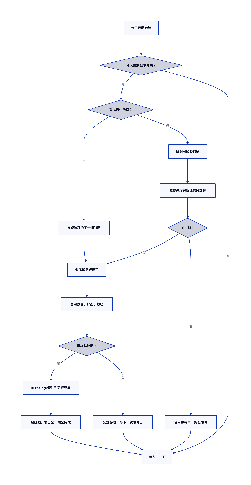

# 事件連鎖與分支劇情：設計規格

這份文件定義「有記憶的突發事件」怎麼運作，並附上六條完整劇本、可驗證的 JSON 資料、以及接進現有 `index.html` 的具體做法。

本次交付包含資料、Schema、劇本全文、流程圖與驗證工具，**尚未改動 `index.html` 的事件流程**。個性系統已經實作並上線，事件鏈則設計成可以獨立接上的模組。

## 為什麼要新增事件鏈

目前版本已經有 44 則內建突發事件，但每一則都是獨立的一次性選擇：兩個選項、套用數值、結束。玩家在第 10 天之後就會開始看到重複的事件，而且遊戲不會記得你上次幫過誰、拒絕過誰。

好感度系統雖然存在，卻只有母牛老師與松露攤老闆兩位角色，而且只影響兩三個選項。結果是：30 天玩完，數值很豐富，故事卻很薄。

事件鏈要解決的是「記憶」與「累積」：

- 同一個角色會在不同時間點再出現，記得你上次的選擇。
- 選擇會留下旗標，後面章節會因為旗標而出現不同選項與結局。
- 一條鏈的結局不是「好／壞」，而是「你這隻豬變成什麼樣的人」。

## 三層架構

第一層是現有的事件池，處理日常的、單點的小狀況。第二層是事件鏈，處理有角色、有前因後果的支線。第三層是旗標與稱號，記錄這局做過什麼，並在結局畫面與成就系統留下痕跡。



事件鏈不會取代現有事件，而是共用同一個「事件日」。有進行中的鏈就接續章節，沒有就照原本的邏輯抽一則突發事件。這樣改動最小，也不會讓玩家覺得每天都在跑連續劇。

## 檔案與工具鏈

`data/events.json` 是劇本正本，所有文字、條件、效果都在這裡。`data/events.schema.json` 是 Draft 2020-12 的 JSON Schema，編輯器可以即時提示錯誤。`data/events.js` 是從 JSON 產生的 `window.PIG_EVENTS`，給瀏覽器直接載入。

`docs/event-scripts.md` 是從 JSON 產生的劇本全文，方便校稿與翻譯。`tests/validate-events.py` 檢查節點引用、旗標、效果範圍與備援結局，`tests/validate-schema.js` 用 Ajv 驗證 Schema，`tests/chain-sim.js` 模擬上千局確認每條鏈與每個結局都玩得到。`tests/render-events.py` 與 `tests/build-events-js.py` 分別重新產生劇本全文與 `events.js`。

之所以同時保留 JSON 與 `events.js`，是因為遊戲要能在 `file://` 直接開啟，也要能離線執行。用 `fetch('./data/events.json')` 在 `file://` 會失敗，用 `<script src="data/events.js">` 則完全沒有這個問題。JSON 是給人編輯的，`events.js` 是給瀏覽器讀的，兩者由指令稿同步。

修改劇本後的標準流程：

```shell
python3 tests/build-events-js.py     # 重新打包給瀏覽器
python3 tests/render-events.py       # 重新產生劇本全文
python3 tests/validate-events.py     # 結構與語意檢查
node tests/validate-schema.js        # Schema 檢查
node tests/chain-sim.js 1500         # 可玩性模擬
```

## 資料結構

### 頂層

`chains` 是劇本陣列，`npcs` 是這份劇本用到的角色，`defaults` 是執行期的預設值：同時最多一條進行中的鏈、鏈結束後冷卻 3 天、最多保留 32 個旗標、鏈最長跨 16 天。

`npcs` 的內容要在整合時合併進遊戲的 NPC 對照表。目前 `renderRelationships` 用三元判斷式硬寫了兩個表情符號，整合時應該改成資料表，否則新增角色會顯示錯誤。

### 一條鏈

`id` 是穩定的英文代號，會寫進存檔，改了等於換一條鏈。`title`、`emoji`、`theme` 是顯示用的。`summary` 是一句話的鉤子，之後可以做「故事圖鑑」。

`trigger` 決定什麼時候可以開始：`day` 是允許的天數區間，`chance` 是符合條件後的抽取機率，`priority` 是與其他鏈競爭時的基礎分數，`requires` 是必要條件。`hidden` 的鏈不會出現在任何提示裡。

`personalityAffinity` 列出對這條鏈特別有共鳴的個性。執行時會給這些個性 +15 分，不是保證抽中，只是提高傾向。這是把個性系統與劇情連起來的地方。

`start` 是起點節點，`nodes` 是節點表，`endings` 是鏈結局，**最後一個必須是無條件備援**。

### 節點

節點是「一章」。`speaker` 顯示在標題，`text` 是敘述或對話，`scene` 是給美術或背景用的標記。

`terminal: true` 代表這是終點，不會有選項。`ending` 可以是 `auto`（依 `endings` 順序與條件判定），也可以直接指定某個結局 id，適合「你轉身就走」這種明確分支。

`dayCost` 可以讓某些章節額外消耗天數，預設 0。大多數情況不需要，因為章節之間本來就隔了 3～4 天。

### 選項

`text` 是玩家看到的按鈕，`result` 是選擇後的敘述。`effects`、`relationship`、`flags` 是實際影響。`next` 指向下一個節點。

`requires` 讓選項有門檻，`locked` 是門檻未達時顯示的提示。**有 `requires` 就一定要有 `locked`**，否則玩家只會看到一個不能按的按鈕，不知道為什麼。

```json
{
  "id": "ask_teacher",
  "text": "去敲母牛老師的門求救",
  "requires": { "relationship": { "teacher": { "min": 15 } } },
  "locked": "母牛老師好感 15 以上",
  "result": "老師披著外套出來，二話不說把阿啾放上背。",
  "effects": { "stamina": -4, "cha": 2, "mood": 3 },
  "relationship": { "teacher": 4, "chick": 6 },
  "flags": { "set": ["chick_teacher"] },
  "next": "n4"
}
```

### 鏈結局與獎勵

結局依陣列順序判定，第一個符合條件的就中選，最後一個沒有條件，所以一定會中。

`reward` 可以給數值、好感、旗標、稱號與日記。`title` 會成為這隻豬的稱號，`log` 會寫進豬豬日記。稱號建議在結局畫面顯示，讓玩家知道這局留下了什麼。

## 條件語法

所有條件都是 AND，沒寫的欄位代表不限制。

```json
{
  "day": { "min": 12, "max": 22 },
  "stats": { "int": { "min": 40 }, "gold": { "max": 100 } },
  "relationship": { "teacher": { "min": 20 } },
  "flags": {
    "all": ["book_open"],
    "any": ["book_kept", "book_shared"],
    "none": ["book_sold"],
    "atLeast": { "count": 3, "of": ["chick_friend", "truffle_hero", "wolf_ally"] }
  },
  "personality": ["scholar", "brave"],
  "mode": "normal",
  "chainDone": ["truffle_secret"],
  "chance": 0.6
}
```

`chance` 只在觸發時使用，節點與選項的條件會忽略它。`atLeast` 是為了隱藏鏈設計的：五條主線中完成任意三條，才會遇到傳說試煉。

## 狀態模型

存檔只需要多一個 `chains` 欄位：

```json
{
  "chains": {
    "active": { "id": "chick_home", "node": "n2", "since": 6 },
    "done": { "chick_home": { "ending": "best_friend", "day": 9 } },
    "flags": ["chick_helped", "chick_friend"],
    "history": ["chick_home:n1:walk_bridge", "chick_home:n2:jump"]
  }
}
```

`active` 記錄進行到哪個節點，關掉頁面再回來可以接續。`done` 記錄完成過的鏈與結局。`flags` 是這局的記憶。`history` 只保留最近 40 筆，用來避免同一條鏈的同一章重複出現，也方便除錯。

現有存檔的 `v` 是 1。建議改成 2，並在 `loadState` 裡補上遷移：

```js
if (s.v === 1) { s.v = 2; s.chains = { active: null, done: {}, flags: [], history: [] }; }
if (!s.chains) s.chains = { active: null, done: {}, flags: [], history: [] };
```

## 觸發與優先序

事件日仍由現有的 `nextEventDay` 控制，一般養成是 3～4 天一次，冒險豬是 2～3 天。事件日到的時候：

1. 如果有 `chains.active`，直接接續該鏈的下一個節點。
2. 否則篩選所有「未完成、不在冷卻、天數符合、條件符合」的鏈，各自算分：`priority` ＋ 個性親和 15 分 ＋ 0～20 的隨機值。
3. 最高分的鏈如果贏過「一般事件」的門檻就開始，否則照舊抽一則單點事件。

建議讓鏈的優先度高於一般事件，因為玩家對連續劇情的期待比較強。如果同時有兩條鏈符合，只會啟動分數高的那條，另一條留到下一次事件日。

鏈進行到第 30 天還沒結束時，直接依現有旗標結算，不要讓玩家在結局畫面看到「待續」。

## 節點推進

玩家選了一個選項之後，依序做五件事：套用數值（經過 `applyDelta` 與個性倍率）、調整好感、設定或清除旗標、寫入歷史、移動到 `next`。

如果 `next` 是終點節點，就顯示該節點的敘述，然後判定鏈結局，發獎勵、寫日記、把鏈標記為完成。

中斷恢復沿用現有的 `pendingEvent` 機制，但要多存一個「這是鏈的哪個節點」。最簡單的做法是把整個節點物件存進 `pendingChain`，和 `pendingEvent` 一樣在 `init` 時接續顯示。

## 六條主線

完整逐字劇本在 [`docs/event-scripts.md`](event-scripts.md)，這裡只講每條線的設計意圖。

**🐥 迷路的小雞（第 4～12 天）** 是新手線，教玩家「事件會記得你」。表面上是帶小雞回家，真正在問的是：你會不會為了一隻小雞停下來。最好的結局需要你先幫牠、再參加牠們的運動會；如果你選擇假裝沒看到，會得到一個很難忘的後悔結局。

**🍄 松露攤的秘密（第 7～18 天）** 是金錢線，也是唯一會直接影響商店經濟的鏈。借錢、改良食譜、漲價是三種完全不同的經營風格。最後供應商要求獨家合約時，玩家的選擇會決定他成為合夥人、合作社推手，還是只是老朋友。

**📕 圖書館的禁書（第 9～20 天）** 是智慧線，負責世界觀。牧場創辦豬阿滿的日記解釋了這座牧場為什麼存在，也讓母牛老師從「功能型 NPC」變成有過去的人。這條線的知識獎勵最高，但拿到之後怎麼處理（公開、獨占、拍賣）才是真正的選擇。

**🐺 牧場保衛戰（第 13～24 天）** 是力量線，但刻意做成「可以不用打架」。狼群不是壞人，只是家被淹了。最好的結局需要同時修水壩與幫小狼包紮，力量與溫柔缺一不可。

**🌠 星空舞台（第 11～22 天）** 是魅力線，處理「要不要離開家鄉」。上台前牧場的大家湊錢做了一套歪歪的表演服，這件事本身就是答案的一部分。

**🌟 傳說豬的試煉（第 21～29 天，隱藏）** 需要前面五條線中完成至少三條才會出現。它不給新的能力，只給一個稱號與一段收束：傳說不是打敗誰，是被記得。

## 與個性系統的關係

個性影響三件事：哪條鏈比較容易出現（`personalityAffinity`）、某些選項的門檻比較好過（學者豬容易通過智慧檢定、運動豬容易通過力量檢定）、以及事件帶來的正向數值（冒險豬 +15%）。

這樣個性就不只是數值倍率，而是會改變玩家看到的故事。學者豬比較常遇到禁書線，明星豬比較常遇到舞台線，同一輪 30 天玩出來的敘事就會不一樣。

## 接進現有程式碼

改動集中在六個地方，都不需要重寫遊戲。

**一、載入劇本。** 在 `game-core.js` 之後加一行：

```html
<script src="data/events.js"></script>
```

**二、`newState` 增加欄位。**

```js
chains: { active: null, done: {}, flags: [], history: [] },
```

**三、`loadState` 補遷移**，見上面的存檔範例。

**四、`checkEventTrigger` 最前面加一條。**

```js
if (s.chains && s.chains.active) {
  return { reason: '事件鏈續章', chain: s.chains.active.id, node: s.chains.active.node };
}
```

**五、`onAction` 把 `runEvent(trig)` 換成 `runChainOrEvent(trig)`。**

```js
async function runChainOrEvent(trig) {
  const chain = PigChains.startOrContinue(state);
  if (!chain) return runEvent(trig);          // 沒鏈就維持原本的單點事件
  await presentChainNode(chain);
}
```

**六、`presentChainNode` 沿用 `presentEvent` 的彈窗外觀**，差別只在標題多一個章節標記、選項要處理 `locked`、結尾要顯示獎勵與稱號。

另外有兩個小地方要順手改：`RELATION_NAMES` 改成包含表情符號的資料表（現在是三元判斷式），以及 `sw.js` 的 `ASSETS` 加入 `./data/events.js` 並把 `CACHE` 版本號加一。

每日挑戰完全不受影響：`getPersonality` 在 daily 模式回傳中立值，事件鏈也應該在 daily 模式停用，維持「全球同一組事件」的承諾。排行榜的驗證邏輯不需要改，因為鏈只影響最終數值，而數值仍然會經過 `validateSubmission` 的範圍檢查。

## 平衡原則

一條鏈的總收益大約等於 2～3 個行動的價值。以 30 天、每天一個行動來看，一條鏈給到 +8 能力、+80G 就已經很甜，再多會讓「努力養成」變得沒有意義。

負向效果要小於正向效果，但必須存在。純獎勵的選擇沒有張力，玩家只會無腦點第一個。比較好的比例是：一個選項賺錢但掉心情，另一個選項加能力但花體力。

旗標只用來記錄「做過什麼」，不要拿來當隱藏分數。玩家看不到旗標，如果結局取決於一個他根本不知道存在的旗標，會覺得被騙。每個旗標都應該對應一個他記得的選擇。

## 寫作規範

節點文字 120 字以內，手機上大約五行。選項文字 20 字以內，結果敘述 70 字以內。使用繁體中文與台灣用語，語氣溫暖、口語、可以自嘲，不要說教。

每個角色要有自己的說話方式：小雞講話斷斷續續，松露攤老闆市儈但心軟，母牛老師句子很長，大野狼句子很短。

不要用「你應該」「正確的選擇是」這種語氣。玩家選了比較自私的選項，就讓他承擔後果，但不要羞辱他。後悔結局要寫得讓人記得，而不是讓人想重開。

## 驗收清單

- 每一條鏈都能從 `start` 走到至少一個終點節點。
- 每一個 `requires` 都有對應的 `locked` 文案。
- 每一個被引用的旗標，都至少在某個選項或獎勵裡被設定。
- 每一條鏈的最後一個結局沒有條件，確保一定有結果。
- 所有鏈結局在模擬中至少被走到一次。
- 每日挑戰不會出現事件鏈。
- 存檔中斷後重新開啟，能接續同一個節點。
- 手機上節點文字不超過五行，按鈕不超過四個。

## 附錄：參考實作

以下程式碼與 `tests/chain-sim.js` 的邏輯一致，接上遊戲時只需要把 `applyDelta`、`adjustRelationships`、`addLog` 換成現有函式。這不是最終版本，但可以直接放進 `event-chains.js` 開始接。

```js
/* event-chains.js：事件鏈執行器（參考實作） */
(function (root) {
  'use strict';
  const DATA = root.PIG_EVENTS;
  if (!DATA) return;
  const CHAINS = DATA.chains;
  const BY_ID = CHAINS.reduce((m, c) => { m[c.id] = c; return m; }, {});

  function chainState(s) {
    if (!s.chains) s.chains = { active: null, done: {}, flags: [], history: [] };
    const c = s.chains;
    if (!Array.isArray(c.flags)) c.flags = [];
    if (!c.done || typeof c.done !== 'object') c.done = {};
    if (!Array.isArray(c.history)) c.history = [];
    return c;
  }
  const hasFlag = (s, f) => chainState(s).flags.includes(f);
  function setFlags(s, ops) {
    if (!ops) return;
    const c = chainState(s);
    for (const f of ops.set || []) if (!c.flags.includes(f)) c.flags.push(f);
    for (const f of ops.clear || []) c.flags = c.flags.filter(x => x !== f);
  }
  function inRange(v, r) {
    if (!r) return true;
    if (r.min !== undefined && v < r.min) return false;
    if (r.max !== undefined && v > r.max) return false;
    return true;
  }
  function conditionsMet(cond, s, opts = {}) {
    if (!cond) return true;
    if (!inRange(s.day, cond.day)) return false;
    for (const [k, r] of Object.entries(cond.stats || {})) if (!inRange(s[k], r)) return false;
    for (const [npc, r] of Object.entries(cond.relationship || {})) if (!inRange((s.relationships || {})[npc] || 0, r)) return false;
    const f = cond.flags;
    if (f) {
      if ((f.all || []).some(x => !hasFlag(s, x))) return false;
      if (f.any && f.any.length && !f.any.some(x => hasFlag(s, x))) return false;
      if ((f.none || []).some(x => hasFlag(s, x))) return false;
      if (f.atLeast && f.atLeast.of.filter(x => hasFlag(s, x)).length < f.atLeast.count) return false;
    }
    if (cond.personality && !cond.personality.includes(s.personality)) return false;
    if (cond.mode && cond.mode !== s.mode) return false;
    if (cond.chainDone && cond.chainDone.some(id => !chainState(s).done[id])) return false;
    if (cond.chance !== undefined && !opts.ignoreChance && Math.random() > cond.chance) return false;
    return true;
  }
  function eligible(s) {
    const c = chainState(s);
    if (s.mode === 'daily') return [];
    return CHAINS.filter(ch => !c.done[ch.id] && conditionsMet(ch.trigger.requires, s));
  }
  function pick(s) {
    const list = eligible(s);
    if (!list.length) return null;
    const score = ch => ch.trigger.priority
      + ((ch.personalityAffinity || []).includes(s.personality) ? 15 : 0)
      + Math.random() * 20;
    return list.reduce((best, ch) => (score(ch) > score(best) ? ch : best));
  }
  function startOrContinue(s) {
    const c = chainState(s);
    if (c.active) return { chain: BY_ID[c.active.id], node: BY_ID[c.active.id].nodes[c.active.node] };
    const chain = pick(s);
    if (!chain) return null;
    c.active = { id: chain.id, node: chain.start, since: s.day };
    return { chain, node: chain.nodes[chain.start] };
  }
  function availableChoices(node, s) {
    return node.choices.filter(ch => conditionsMet(ch.requires, s));
  }
  function choose(s, chain, choice) {
    applyDelta(s, choice.effects || {});
    adjustRelationships(s, choice.relationship || {});
    setFlags(s, choice.flags);
    const c = chainState(s);
    c.history.push(`${chain.id}:${c.active.node}:${choice.id}`);
    if (c.history.length > DATA.defaults.historyLimit) c.history.shift();
    if (choice.next === c.active.node) return null;
    c.active.node = choice.next;
    return chain.nodes[choice.next];
  }
  function finish(s, chain, node) {
    const c = chainState(s);
    const ending = node.ending && node.ending !== 'auto'
      ? chain.endings.find(e => e.id === node.ending)
      : chain.endings.find(e => conditionsMet(e.requires, s));
    if (!ending) return null;
    applyDelta(s, ending.reward.effects || {});
    adjustRelationships(s, ending.reward.relationship || {});
    setFlags(s, ending.reward.flags);
    c.done[chain.id] = { ending: ending.id, day: s.day };
    c.active = null;
    if (ending.reward.log) addLog(ending.reward.log, 'ev');
    return ending;
  }
  root.PigChains = { chainState, conditionsMet, eligible, pick, startOrContinue, availableChoices, choose, finish };
})(typeof globalThis !== 'undefined' ? globalThis : window);
```

`choose` 之後如果回傳 `null`，代表節點編號沒有前進（例如同一個節點重複），正常劇本不應該發生，可以用來偵測資料錯誤。實際接線時，`finish` 要在顯示終點敘述之後才呼叫，讓玩家先讀完文字再看結局。
