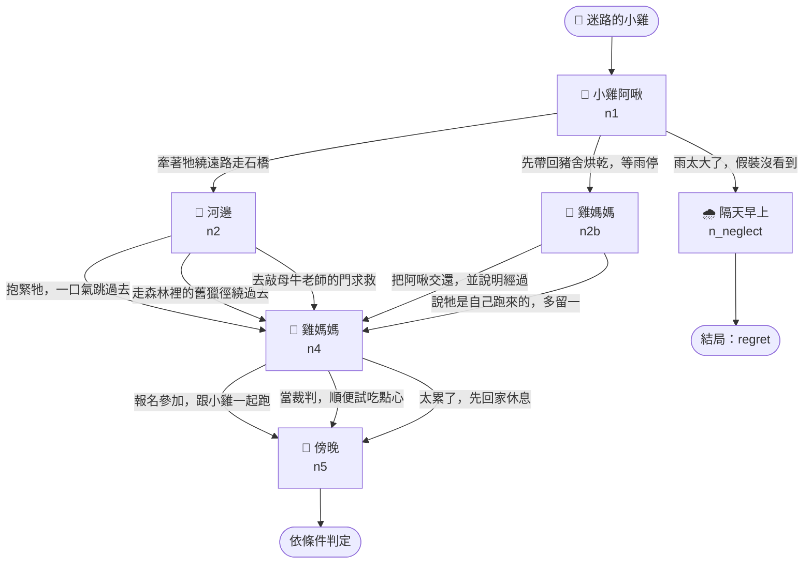
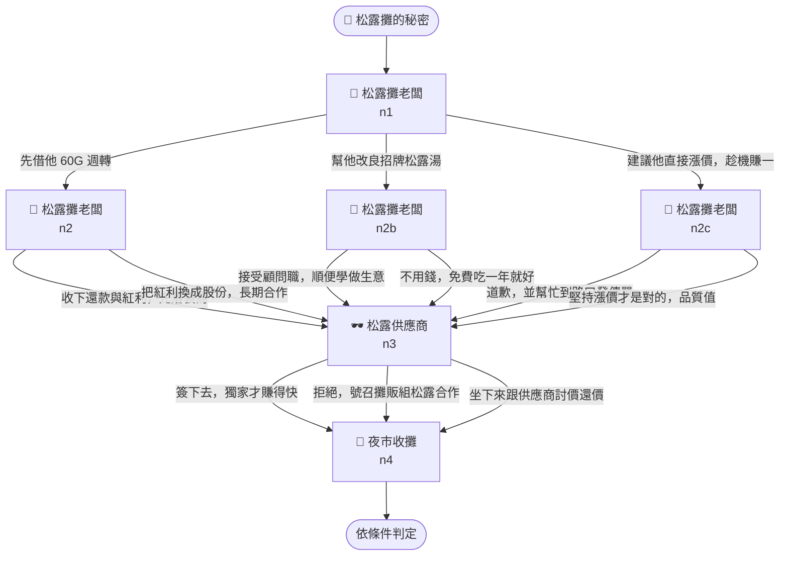
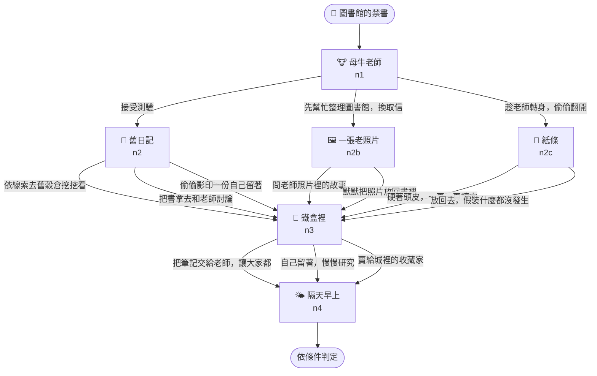
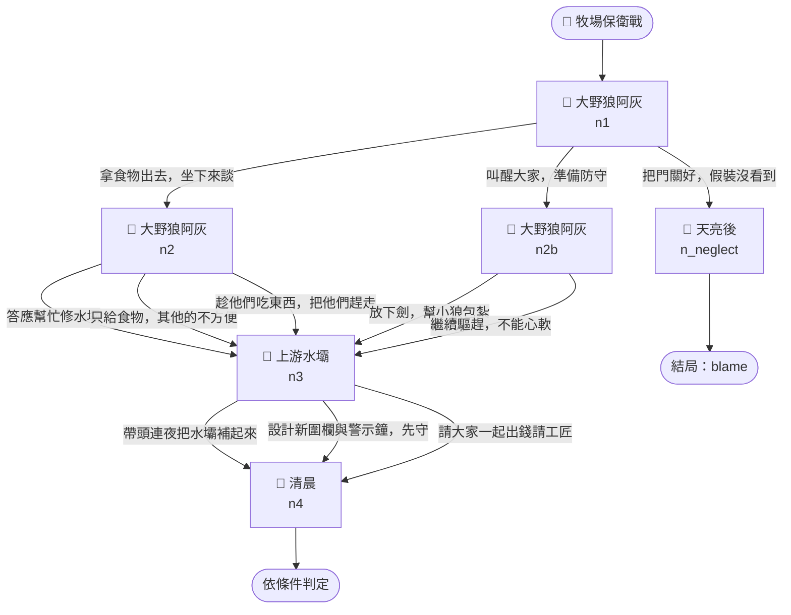
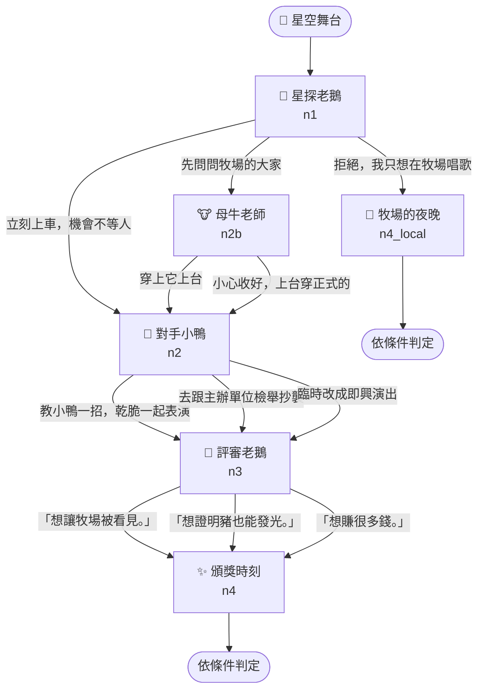
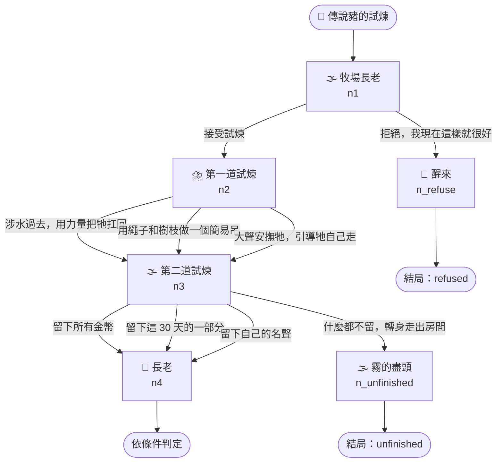

# 事件連鎖劇本全文

> 本文件由 `tests/render-events.py` 從 `data/events.json` 自動產生，請不要手動編輯。

> 修改劇本請改 JSON，再執行 `python3 tests/render-events.py` 重新產生。

目前共 **6 條事件鏈**、36 個節點、67 個選項、19 個鏈結局。

## 目錄

- [🐥 迷路的小雞（`chick_home`）](#chick_home)
- [🍄 松露攤的秘密（`truffle_secret`）](#truffle_secret)
- [📕 圖書館的禁書（`forbidden_book`）](#forbidden_book)
- [🐺 牧場保衛戰（`wolf_siege`）](#wolf_siege)
- [🌠 星空舞台（`star_stage`）](#star_stage)
- [🌟 傳說豬的試煉（`legend_trial`）](#legend_trial)

## 🐥 迷路的小雞

`chick_home`｜主題：暖心｜雨天裡，一隻小雞在牧場門口發抖。牠的媽媽在河的對岸，而橋已經被大水沖壞了一半。

- 個性偏好：明星豬、平凡小豬、吃貨豬
- 觸發條件：沒有 `chick_home_done`
- 觸發時間：第 4～12 天，優先度 20

### n1｜🐥 小雞阿啾

> 「嗚……我找不到媽媽。」小雞阿啾全身濕透，站在牧場門口的泥水裡發抖。牠說媽媽在河對岸的雞舍，可是平常走的木橋被大水沖壞了。

- **A. 牽著牠繞遠路走石橋** → `n2`
  - 結果：你們走了好久，阿啾一路上緊緊抓著你的蹄。石橋雖然遠，但很穩。
  - 變化：體力 -8、魅力 +3、心情 +2｜小雞阿啾 好感 +6｜獲得 `chick_helped`
- **B. 先帶回豬舍烘乾，等雨停** → `n2b`
  - 結果：你用乾草把阿啾包起來，牠在你腳邊睡著了，還打呼。
  - 變化：體力 +4、心情 +3、體重 +1kg｜小雞阿啾 好感 +4｜獲得 `chick_sheltered`
- **C. 雨太大了，假裝沒看到** → `n_neglect`
  - 結果：你轉身回屋裡，卻一直聽見門外細細的啾啾聲。
  - 變化：心情 -6、魅力 -3｜獲得 `chick_regret`

### n2｜🌉 河邊

> 石橋前的最後一段路被沖出一個大缺口，底下的水又急又濁。阿啾看著缺口，腳一直在抖。

- **A. 🔒 抱緊牠，一口氣跳過去** → `n4`
  - 解鎖條件：力量 25 以上才抱得動
  - 條件：力量 ≥ 25
  - 結果：你退後兩步、用力一跳，落地時泥水濺得老高。阿啾在你懷裡尖叫完，開心地啾了一聲。
  - 變化：體力 -12、力量 +3、心情 +4｜小雞阿啾 好感 +8｜獲得 `chick_brave`
- **B. 走森林裡的舊獵徑繞過去** → `n4`
  - 結果：你用樹枝探路，避開兩個泥坑，還在路邊發現一叢野莓。
  - 變化：體力 -15、智慧 +2、心情 +2｜小雞阿啾 好感 +5｜獲得 `chick_forest`
- **C. 🔒 去敲母牛老師的門求救** → `n4`
  - 解鎖條件：母牛老師好感 15 以上
  - 條件：母牛老師好感 ≥ 15
  - 結果：老師披著外套出來，二話不說把阿啾放上背，帶你們走另一條沒被沖壞的路。
  - 變化：體力 -4、魅力 +2、心情 +3｜母牛老師 好感 +4、小雞阿啾 好感 +6｜獲得 `chick_teacher`

### n2b｜🐔 雞媽媽

> 雨停後，雞媽媽一路找來，著急地在豬舍外叫著阿啾的名字。阿啾醒來，卻捨不得離開你身邊。

- **A. 把阿啾交還，並說明經過** → `n4`
  - 結果：雞媽媽連聲道謝，還塞給你一籃剛下的蛋。阿啾回頭對你啾了好幾聲。
  - 變化：魅力 +4、心情 +5、豬豬幣 +10G｜小雞阿啾 好感 +8｜獲得 `chick_honest`
- **B. 說牠是自己跑來的，多留一晚** → `n4`
  - 結果：雞媽媽半信半疑地走了。阿啾很開心，但你整晚都睡不太好。
  - 變化：心情 -3、魅力 -2、體重 +1kg｜小雞阿啾 好感 +4｜獲得 `chick_secret`

### n_neglect｜🌧️ 隔天早上（結束節點）

> 門口只剩一小排濕腳印，往河邊去了。你聽說有隻小雞在河堤哭了一整晚，後來被路過的鴨子帶走。

→ 結局判定：`regret`

### n4｜🐔 雞媽媽

> 雞舍裡熱鬧得像過年。為了謝謝你，雞媽媽邀請你參加明天的小雞運動會，還說冠軍有一份神祕獎品。

- **A. 報名參加，跟小雞一起跑** → `n5`
  - 結果：你在泥地上跌了兩次，最後用滾的滾過終點線。全場小雞笑到站不起來，還是把冠軍給了你。
  - 變化：體力 -10、力量 +3、魅力 +2、豬豬幣 +15G、心情 +5｜小雞阿啾 好感 +6｜獲得 `chick_festival`
- **B. 當裁判，順便試吃點心** → `n5`
  - 結果：你非常公正，唯一有爭議的是你把「最佳點心獎」頒給了自己。
  - 變化：智慧 +3、魅力 +2、體重 +2kg、豬豬幣 +10G、心情 +4｜小雞阿啾 好感 +4｜獲得 `chick_festival`
- **C. 太累了，先回家休息** → `n5`
  - 結果：你睡了一整天。醒來時門口放著一小籃蛋，還有一張歪歪扭扭的「謝謝豬豬」。
  - 變化：體力 +12、心情 +3｜小雞阿啾 好感 +3

### n5｜🌅 傍晚（結束節點）

> 夕陽把雞舍染成橘色。阿啾站在籬笆上對你揮翅膀，雞媽媽說，以後牧場的門永遠為你開著。

→ 結局判定：`auto`

### 鏈結局

#### 🐥 小雞的最佳豬隊友（`best_friend`）

- 條件：同時有 `chick_helped`、`chick_festival`
> 從那天起，阿啾每天都會來牧場門口報到。牠說長大以後要當你的助理，現在先從「幫忙吃點心」開始練習。

- 獎勵：魅力 +6、心情 +10｜小雞阿啾 好感 +15｜獲得 `chick_friend`、`chick_home_done`
- 稱號：小雞守護者
- 日記：🐥 阿啾成為你的頭號粉絲，牧場從此多了一個小小跟班。

#### 🌧️ 雨裡的那聲啾（`regret`）

- 條件：同時有 `chick_regret`
> 之後每次下雨，你都會想起門口那聲細細的啾。你告訴自己，下次一定要開門。

- 獎勵：心情 -4、魅力 -2｜獲得 `chick_home_done`、`chick_regret_done`
- 日記：🌧️ 你決定下次不要再假裝沒聽到。

#### ☔ 雨天的好心豬（`good_deed`）

- 條件：無條件
> 你沒有因此變成英雄，但雞舍的大家都記得那個下雨天，有一隻豬願意停下來。

- 獎勵：魅力 +3、豬豬幣 +10G｜小雞阿啾 好感 +6｜獲得 `chick_home_done`
- 日記：🐔 雞舍的大家開始對你特別友善。

## 🍄 松露攤的秘密

`truffle_secret`｜主題：金錢｜松露攤老闆的供應商一夜之間漲了三倍，攤位明天可能就撐不下去。

- 個性偏好：吃貨豬、學者豬、冒險豬
- 觸發條件：豬豬幣 ≥ 20；沒有 `truffle_secret_done`
- 觸發時間：第 7～18 天，優先度 30

### n1｜🍄 松露攤老闆

> 老闆把你拉到布簾後面，聲音壓得很低：「供應商說松露漲三倍，我明天就付不出錢了。小豬，你腦筋好，幫我想想辦法好不好？」

- **A. 🔒 先借他 60G 週轉** → `n2`
  - 解鎖條件：需要 60G
  - 條件：豬豬幣 ≥ 60
  - 結果：老闆握著你的蹄，眼眶都紅了。他說這輩子沒遇過這麼夠義氣的豬。
  - 變化：豬豬幣 -60G、心情 +3｜松露攤老闆 好感 +10｜獲得 `truffle_loan`
- **B. 幫他改良招牌松露湯** → `n2b`
  - 結果：你把湯熬到第三鍋才成功。老闆喝了一口，沉默三秒，然後開始哭。
  - 變化：體力 -8、智慧 +3、心情 +4｜松露攤老闆 好感 +6｜獲得 `truffle_recipe`
- **C. 建議他直接漲價，趁機賺一筆** → `n2c`
  - 結果：老闆半信半疑地換了價目牌。那天下午，攤位前一個人也沒有。
  - 變化：豬豬幣 +15G、魅力 -1｜松露攤老闆 好感 -4｜獲得 `truffle_price`

### n2｜🍄 松露攤老闆

> 一週後，老闆把錢還給你，還多了一小袋金幣。「這是紅利。要不要乾脆跟我合夥？我出技術，你出腦袋。」

- **A. 收下還款與紅利，先落袋為安** → `n3`
  - 結果：金幣在口袋裡叮噹作響，你覺得自己離首富又近了一步。
  - 變化：豬豬幣 +85G、心情 +5｜松露攤老闆 好感 +4｜獲得 `truffle_repaid`
- **B. 把紅利換成股份，長期合作** → `n3`
  - 結果：你們在餐巾紙上寫下合約，老闆還鄭重地蓋了一個蘑菇印章。
  - 變化：豬豬幣 +30G、智慧 +2、心情 +6｜松露攤老闆 好感 +8｜獲得 `truffle_partner`

### n2b｜🍄 松露攤老闆

> 新湯品大受歡迎，隊伍排到路口。老闆擦著汗問你：「要不要當我的研發顧問？薪水不多，但松露管飽。」

- **A. 接受顧問職，順便學做生意** → `n3`
  - 結果：你開始記帳、試味道、跟客人聊天。原來一碗湯背後有這麼多學問。
  - 變化：豬豬幣 +50G、智慧 +3、心情 +3｜松露攤老闆 好感 +7｜獲得 `truffle_consult`
- **B. 不用錢，免費吃一年就好** → `n3`
  - 結果：老闆大笑三聲，給了你一張手寫的「終身免費」小卡。你當場用了三次。
  - 變化：體力 +20、體重 +4kg、心情 +8｜松露攤老闆 好感 +9｜獲得 `truffle_vip`

### n2c｜🍄 松露攤老闆

> 「漲價是你說的，現在客人跑光了。」老闆蹲在攤位後面，聲音有點悶。隔壁攤位倒是排滿了人。

- **A. 道歉，並幫忙到路口發傳單** → `n3`
  - 結果：你穿著圍裙在路口跳了半小時，客人慢慢回來了。老闆偷偷多給了你一碗湯。
  - 變化：體力 -8、魅力 +3、豬豬幣 +5G、心情 +2｜松露攤老闆 好感 +5｜獲得 `truffle_apology`
- **B. 堅持漲價才是對的，品質值得** → `n3`
  - 結果：你說得頭頭是道，老闆雖然還是不太高興，但默默把價格留下了。
  - 變化：智慧 +2、豬豬幣 +10G｜松露攤老闆 好感 -5｜獲得 `truffle_insist`

### n3｜🕶️ 松露供應商

> 一輛黑色小車停在攤位前。供應商遞出合約：「簽了它，全牧場只有你能賣松露。其他人？斷貨。」老闆緊張地看著你。

- **A. 簽下去，獨家才賺得快** → `n4`
  - 結果：你簽了名，金幣立刻到帳。但隔壁攤販看你的眼神，變得很不一樣。
  - 變化：豬豬幣 +90G、魅力 -4｜松露攤老闆 好感 -8｜獲得 `truffle_exclusive`
- **B. 🔒 拒絕，號召攤販組松露合作社** → `n4`
  - 解鎖條件：魅力 35 以上才說得動大家
  - 條件：魅力 ≥ 35
  - 結果：你把所有攤販叫到廣場，講到喉嚨沙啞。最後大家舉手通過：一起進貨、一起定價。供應商摸摸鼻子走了。
  - 變化：體力 -10、魅力 +5、心情 +8｜松露攤老闆 好感 +10｜獲得 `truffle_coop`
- **C. 🔒 坐下來跟供應商討價還價** → `n4`
  - 解鎖條件：智慧 40 以上才談得動
  - 條件：智慧 ≥ 40
  - 結果：你把成本、運費、損耗算得清清楚楚，最後談到一個雙方都能接受的價格，還保住其他攤位。
  - 變化：智慧 +3、豬豬幣 +60G、心情 +4｜松露攤老闆 好感 +8｜獲得 `truffle_deal`

### n4｜🏮 夜市收攤（結束節點）

> 夜深了，松露攤的燈還亮著。老闆把最後一碗湯推到你面前，什麼都沒說，只是笑。

→ 結局判定：`auto`

### 鏈結局

#### 🤝 松露合作社的推手（`coop_hero`）

- 條件：同時有 `truffle_coop`
> 合作社成立那天，攤販們在廣場辦了一場流水席。你被推上台，大家說你是「讓小攤位也能站直」的那隻豬。

- 獎勵：豬豬幣 +60G、魅力 +5、心情 +10｜松露攤老闆 好感 +12｜獲得 `truffle_secret_done`、`truffle_hero`
- 稱號：市場公道伯
- 日記：🤝 松露合作社成立，你成了攤販們最信任的那隻豬。

#### 🍄 松露攤的合夥豬（`partner`）

- 條件：任一個 `truffle_partner`、`truffle_consult`、`truffle_exclusive`
> 你和老闆把攤位重新裝潢，招牌上多了一隻小豬的圖案。生意好到要抽號碼牌。

- 獎勵：豬豬幣 +80G、智慧 +3、心情 +6｜松露攤老闆 好感 +10｜獲得 `truffle_secret_done`、`truffle_rich`
- 稱號：松露合夥豬
- 日記：🍄 你正式成為松露攤的合夥豬。

#### 🍲 松露攤的老朋友（`friend`）

- 條件：無條件
> 攤位沒有變大，但每天收攤時，老闆都會留一碗湯給你。你們誰也沒提合約的事。

- 獎勵：豬豬幣 +40G、心情 +6｜松露攤老闆 好感 +8｜獲得 `truffle_secret_done`
- 日記：🍲 你和松露攤老闆成了會互相留一碗湯的朋友。

## 📕 圖書館的禁書

`forbidden_book`｜主題：神秘｜母牛老師拿出一本沒有書名的舊書，說要通過三題測驗才能借。書裡藏著牧場創辦豬的日記。

- 個性偏好：學者豬、冒險豬、平凡小豬
- 觸發條件：沒有 `forbidden_book_done`
- 觸發時間：第 9～20 天，優先度 25

### n1｜🐮 母牛老師

> 圖書館快關門時，老師從最上層拿下一個沒有標籤的木盒。「這本書只有通過三題測驗的人能借。要試試嗎？」

- **A. 🔒 接受測驗** → `n2`
  - 解鎖條件：智慧 30 以上才答得出來
  - 條件：智慧 ≥ 30
  - 結果：三題你答對兩題半，最後一題老師說「算你過」。她笑著把書推過來。
  - 變化：體力 -6、智慧 +4、心情 +4｜母牛老師 好感 +6｜獲得 `book_open`
- **B. 先幫忙整理圖書館，換取信任** → `n2b`
  - 結果：你把三十年的舊報紙按年份排好，老師看你的眼神變得不太一樣。
  - 變化：體力 -10、智慧 +1｜母牛老師 好感 +8｜獲得 `book_trust`
- **C. 趁老師轉身，偷偷翻開** → `n2c`
  - 結果：書頁一翻開就掉出一張紙條：「偷看的人，要負責把書讀完。」你覺得背後涼涼的。
  - 變化：智慧 +2、心情 -3｜母牛老師 好感 -4｜獲得 `book_stolen`

### n2｜📖 舊日記

> 書裡是牧場創辦豬「阿滿」的日記。最後一頁寫著：「我把最重要的東西，藏在每天都會踩過的地方。」下面畫了一個歪歪的穀倉。

- **A. 依線索去舊穀倉挖挖看** → `n3`
  - 結果：你在穀倉地板下摸到一個冰涼的鐵盒，心跳得比跑百米還快。
  - 變化：體力 -12、智慧 +2、心情 +3｜獲得 `book_clue`
- **B. 把書拿去和老師討論** → `n3`
  - 結果：老師看到日記愣了很久，說阿滿是她的老師。你們一起把線索拼了出來。
  - 變化：智慧 +3、心情 +5｜母牛老師 好感 +8｜獲得 `book_teacher`
- **C. 偷偷影印一份自己留著** → `n3`
  - 結果：影印機卡了兩次紙，你緊張得滿頭大汗，最後還是成功帶走一份。
  - 變化：智慧 +2、魅力 -2、心情 -2｜獲得 `book_copy`

### n2b｜🖼️ 一張老照片

> 書頁間夾著一張泛黃照片：年輕的老師站在一隻戴著草帽的豬旁邊，背景是剛蓋好的圖書館。

- **A. 問老師照片裡的故事** → `n3`
  - 結果：老師說阿滿教她識字，還把第一本書送給她。「所以我才一直守著這間圖書館。」
  - 變化：心情 +8、智慧 +2｜母牛老師 好感 +10｜獲得 `teacher_past`、`book_teacher`
- **B. 默默把照片放回書裡** → `n3`
  - 結果：你沒有多問，但記住了照片裡那隻豬的笑容。
  - 變化：智慧 +2、心情 +2｜母牛老師 好感 +4｜獲得 `book_photo`

### n2c｜📕 紙條

> 紙條背面還有一行小字：「讀完它，否則它會跟著你。」你翻開第一頁，發現整本書都是手寫的。

- **A. 硬著頭皮，一頁一頁讀完** → `n3`
  - 結果：你讀到天亮，眼睛快睜不開，但腦子裡像開了一扇窗。
  - 變化：體力 -15、智慧 +6、心情 +3｜獲得 `book_read`
- **B. 放回去，假裝什麼都沒發生** → `n3`
  - 結果：你把書塞回木盒，卻整晚覺得有人在圖書館裡翻頁。
  - 變化：心情 -6｜母牛老師 好感 -2｜獲得 `book_guilt`

### n3｜🔖 鐵盒裡

> 鐵盒裡有一本手寫的《牧場經營筆記》，和一枚刻著豬頭的舊徽章。筆記第一頁寫著：「給下一個願意留下來的人。」

- **A. 把筆記交給老師，讓大家都能讀** → `n4`
  - 結果：老師把筆記放進玻璃櫃，還辦了一場小小的展覽。牧場的孩子們排隊來看。
  - 變化：魅力 +4、心情 +6｜母牛老師 好感 +10｜獲得 `book_shared`
- **B. 自己留著，慢慢研究** → `n4`
  - 結果：你每晚睡前讀兩頁，越讀越覺得，這座牧場比想像中更深。
  - 變化：智慧 +6、心情 +3｜獲得 `book_kept`
- **C. 賣給城裡的收藏家** → `n4`
  - 結果：收藏家付了一大筆錢，把鐵盒整個帶走。你數錢的時候，手指有點抖。
  - 變化：豬豬幣 +90G、魅力 -3、心情 -4｜母牛老師 好感 -8｜獲得 `book_sold`

### n4｜🌤️ 隔天早上（結束節點）

> 圖書館的窗戶透進陽光，灰塵在光裡慢慢飄。你忽然明白，阿滿說的「每天都會踩過的地方」，其實是這座牧場本身。

→ 結局判定：`auto`

### 鏈結局

#### 📜 牧場見習生（`heir`）

- 條件：同時有 `book_shared`
> 老師把舊徽章別在你身上，說這是阿滿留下的見習生徽章。從今天起，你有了新的功課。

- 獎勵：智慧 +5、魅力 +3、心情 +8｜母牛老師 好感 +10｜獲得 `forbidden_book_done`、`ranch_heir`
- 稱號：牧場見習生
- 日記：📜 你接下阿滿的筆記與徽章，成為牧場的見習生。

#### 📚 藏書的守護者（`secret_scholar`）

- 條件：任一個 `book_kept`、`book_read`、`book_copy`
> 你沒有把筆記公開，但每一頁都記在腦子裡。牧場的人只知道，那隻豬懂的比看起來多很多。

- 獎勵：智慧 +8、心情 +4｜獲得 `forbidden_book_done`、`secret_scholar`
- 稱號：藏書守護者
- 日記：📚 你把阿滿的筆記讀完了，知識成了你最安靜的武器。

#### 💸 鐵盒的重量（`sold_out`）

- 條件：無條件
> 金幣很沉，但沒有鐵盒那麼沉。你偶爾會想，如果當初打開的是另一頁，現在會不會不一樣。

- 獎勵：豬豬幣 +30G、心情 -5｜獲得 `forbidden_book_done`、`book_regret`
- 日記：💸 你賣掉了阿滿的筆記，口袋滿了，心裡空了一點。

## 🐺 牧場保衛戰

`wolf_siege`｜主題：勇氣｜深夜，狼群出現在圍欄外。帶頭的大野狼說他們不是來打架的，但牧場的大家已經拿起了掃把。

- 個性偏好：運動豬、冒險豬
- 觸發條件：力量 ≥ 25；沒有 `wolf_siege_done`
- 觸發時間：第 13～24 天，優先度 35

### n1｜🐺 大野狼阿灰

> 圍欄外站著六雙發亮的眼睛。帶頭的大野狼舉起前掌：「我們不是來打架的。上游的水壩壞了，我們的窩被淹了，只是餓。」

- **A. 🔒 拿食物出去，坐下來談** → `n2`
  - 解鎖條件：需要 30G 買食物
  - 條件：豬豬幣 ≥ 30
  - 結果：你把麵包和乾草推過去。阿灰愣了一下，慢慢坐下，其他狼也跟著坐下了。
  - 變化：豬豬幣 -30G、魅力 +2、心情 +2｜大野狼阿灰 好感 +6｜獲得 `wolf_talk`
- **B. 叫醒大家，準備防守** → `n2b`
  - 結果：你敲響鐵盆，牧場的燈一盞盞亮起來。狼群退到樹林邊，但沒有離開。
  - 變化：力量 +2、魅力 +2、體力 -8｜獲得 `wolf_fight`
- **C. 把門關好，假裝沒看到** → `n_neglect`
  - 結果：你回到床上，卻整夜聽見圍欄被輕輕推擠的聲音。
  - 變化：心情 -5、體力 +5｜獲得 `wolf_ignore`

### n2｜🐺 大野狼阿灰

> 阿灰咬著麵包，聲音低下來：「水壩不修，明年春天整個河谷都會淹。可是沒有人願意幫狼。」

- **A. 答應幫忙修水壩** → `n3`
  - 結果：阿灰看著你很久，最後伸出前掌。「你是我遇過最奇怪的豬。」
  - 變化：體力 -6、力量 +2、心情 +4｜大野狼阿灰 好感 +8｜獲得 `dam_promise`
- **B. 只給食物，其他的不方便** → `n3`
  - 結果：阿灰道了謝，帶著狼群走了。你知道這件事沒有結束。
  - 變化：豬豬幣 -20G、心情 +1｜大野狼阿灰 好感 +3｜獲得 `wolf_food_only`
- **C. 🔒 趁他們吃東西，把他們趕走** → `n3`
  - 解鎖條件：力量 40 以上才推得動
  - 條件：力量 ≥ 40
  - 結果：你推倒柵欄邊的草堆，狼群嚇得四散。阿灰回頭看了你一眼，那一眼你記了很久。
  - 變化：力量 +4、魅力 -4、心情 -3｜大野狼阿灰 好感 -10｜獲得 `wolf_betray`

### n2b｜🐺 大野狼阿灰

> 你舉起木劍站在圍欄前，狼群沒有前進。忽然，一隻小狼踩到碎木片跌倒，嗚嗚地叫。

- **A. 放下劍，幫小狼包紮** → `n3`
  - 結果：你撕下衣角替牠包好。阿灰的耳朵慢慢放下來，其他狼也退了半步。
  - 變化：魅力 +4、心情 +4｜大野狼阿灰 好感 +7｜獲得 `wolf_mercy`
- **B. 繼續驅趕，不能心軟** → `n3`
  - 結果：狼群退進樹林。地上留下幾滴血，你告訴自己那是必要的。
  - 變化：力量 +4、魅力 -3、心情 -4｜大野狼阿灰 好感 -8｜獲得 `wolf_hard`

### n_neglect｜🌅 天亮後（結束節點）

> 隔天早上，雞舍被翻得亂七八糟，飼料袋破了三個。大家站在門口看著你，沒有人說話。

→ 結局判定：`blame`

### n3｜🌊 上游水壩

> 天亮後你走到上游，水壩果然裂了一大條縫。再下一次大雨，整個河谷都會被淹，包括牧場。

- **A. 帶頭連夜把水壩補起來** → `n4`
  - 結果：你和狼群搬了一整夜的石頭。天亮時，裂縫終於被堵住，大家躺在地上喘氣，然後一起笑了。
  - 變化：體力 -20、力量 +5、心情 +6｜大野狼阿灰 好感 +8｜獲得 `dam_fixed`
- **B. 設計新圍欄與警示鐘，先守住牧場** → `n4`
  - 結果：你畫了三天圖，做出一個會響的警示鐘。牧場的大家晚上終於能睡好覺。
  - 變化：智慧 +4、豬豬幣 -20G、心情 +3｜獲得 `fence_built`
- **C. 🔒 請大家一起出錢請工匠** → `n4`
  - 解鎖條件：魅力 40 以上才號召得動
  - 條件：魅力 ≥ 40
  - 結果：你在廣場講了十分鐘，最後連最吝嗇的老鵝都掏了錢。工匠三天就修好了水壩。
  - 變化：豬豬幣 -40G、魅力 +5、心情 +5｜獲得 `ranch_united`

### n4｜🌄 清晨（結束節點）

> 太陽從山後升起來，水壩靜靜地立在那裡。阿灰站在遠處的山丘上，對你點了點頭，然後帶著狼群走進森林。

→ 結局判定：`auto`

### 鏈結局

#### 🤝 狼與豬的和平條約（`peace`）

- 條件：同時有 `dam_fixed`、`wolf_mercy`
> 後來，狼群偶爾會來牧場邊緣喝水，但再也沒有靠近雞舍。阿灰說，這是狼族第一次和豬簽條約，條約寫在一塊木板上。

- 獎勵：力量 +5、魅力 +5、心情 +10｜大野狼阿灰 好感 +15｜獲得 `wolf_siege_done`、`wolf_ally`
- 稱號：牧場守護者
- 日記：🤝 你和狼群簽下和平條約，牧場從此有了森林裡的盟友。

#### 🛡️ 牧場的守夜豬（`guardian`）

- 條件：任一個 `fence_built`、`ranch_united`、`dam_promise`
> 圍欄修好了，警示鐘也掛上了。大家說，晚上聽到鐘聲就安心，因為知道有隻豬會醒著。

- 獎勵：力量 +4、魅力 +3、心情 +6｜大野狼阿灰 好感 +4｜獲得 `wolf_siege_done`、`ranch_guard`
- 稱號：牧場守衛
- 日記：🛡️ 你成了牧場夜裡最可靠的那道牆。

#### 🌾 沒有人說話的早上（`blame`）

- 條件：同時有 `wolf_ignore`
> 你幫忙收拾了一整個上午，大家沒有責備你，但也沒有像以前那樣找你聊天。

- 獎勵：魅力 -3、心情 -6｜獲得 `wolf_siege_done`、`wolf_regret`
- 日記：🌾 你決定以後聽到聲音，一定要開門看看。

#### 🌙 安靜的夜晚（`quiet_night`）

- 條件：無條件
> 狼群沒有再來，水壩也撐過了雨季。牧場恢復平靜，只是偶爾夜裡，你還是會往圍欄外多看兩眼。

- 獎勵：心情 +3｜獲得 `wolf_siege_done`
- 日記：🌙 牧場度過了那個不平靜的夜晚。

## 🌠 星空舞台

`star_stage`｜主題：夢想｜城市來的星探老鵝說，今晚就要帶你去參加「銀河新星大賽」。故鄉與舞台，只能選一個先。

- 個性偏好：明星豬、冒險豬、平凡小豬
- 觸發條件：魅力 ≥ 30；沒有 `star_stage_done`
- 觸發時間：第 11～22 天，優先度 28

### n1｜🦢 星探老鵝

> 一輛貼滿海報的巴士停在牧場門口。老鵝推了推墨鏡：「銀河新星大賽今晚初選，我看你有潛力。上車嗎？車不等豬。」

- **A. 立刻上車，機會不等人** → `n2`
  - 結果：你連行李都沒帶就跳上車。巴士開動時，你看到牧場的燈越來越小。
  - 變化：體力 -10、豬豬幣 -20G、心情 +4｜獲得 `stage_go`
- **B. 先問問牧場的大家** → `n2b`
  - 結果：大家七嘴八舌，最後母牛老師說：「去吧，但記得回來。」還有人塞給你一包餅乾。
  - 變化：魅力 +3、心情 +6｜母牛老師 好感 +4｜獲得 `stage_ask`
- **C. 拒絕，我只想在牧場唱歌** → `n4_local`
  - 結果：老鵝挑眉看了你一眼，留下一張名片就走了。你在籬笆邊唱了一整晚，小雞們聽得入迷。
  - 變化：心情 +10、魅力 +2｜獲得 `stage_stay`

### n2｜🦆 對手小鴨

> 後台擠滿了參賽者。你發現隔壁的小鴨正在練習一段舞蹈，跟你昨晚在牧場跳的一模一樣。

- **A. 教小鴨一招，乾脆一起表演** → `n3`
  - 結果：你們把兩段舞合成一段，還加了一個一起轉圈的結尾。排練時評審探頭看了兩次。
  - 變化：體力 -8、魅力 +5、心情 +6｜獲得 `stage_duet`
- **B. 去跟主辦單位檢舉抄襲** → `n3`
  - 結果：主辦單位說「動作沒有版權」，只把你們的順序錯開。小鴨低著頭走了。
  - 變化：智慧 +2、魅力 -4、心情 -3｜獲得 `stage_report`
- **C. 🔒 臨時改成即興演出** → `n3`
  - 解鎖條件：魅力 35 以上才撐得住即興
  - 條件：魅力 ≥ 35
  - 結果：你丟掉排好的舞步，跟著音樂亂轉，結果全場跟著你一起轉。評審的筆停在半空中。
  - 變化：魅力 +6、體力 -10、心情 +8｜獲得 `stage_improv`

### n2b｜🐮 母牛老師

> 出發前，大家從背後拿出一套用窗簾和亮片縫的表演服，歪歪的，但閃閃發光。「不知道合不合身，你穿穿看。」

- **A. 穿上它上台** → `n2`
  - 結果：衣服有點緊，但你覺得自己是全場最亮的那顆星。後台的化妝師還問這是哪個品牌。
  - 變化：魅力 +4、心情 +8｜母牛老師 好感 +4｜獲得 `stage_suit`
- **B. 小心收好，上台穿正式的** → `n2`
  - 結果：你把表演服摺好放進包包。上台前摸了一下，覺得比較不緊張。
  - 變化：魅力 +2、心情 +4｜獲得 `stage_suit_kept`

### n3｜🦢 評審老鵝

> 決賽的燈光亮得看不見觀眾。老鵝把麥克風遞給你：「最後一題。你為什麼想紅？」

- **A. 「想讓牧場被看見。」** → `n4`
  - 結果：台下安靜了一秒，然後響起掌聲。你看到後台有人偷偷擦眼淚。
  - 變化：魅力 +6、心情 +6｜獲得 `stage_home`
- **B. 「想證明豬也能發光。」** → `n4`
  - 結果：老鵝笑了一下：「這答案我聽了三十年，但今天第一次相信。」
  - 變化：魅力 +5、智慧 +2、心情 +5｜獲得 `stage_prove`
- **C. 「想賺很多錢。」** → `n4`
  - 結果：全場笑了，評審也笑了。你不太確定那是好事還是壞事，但經紀公司倒是立刻遞了名片。
  - 變化：豬豬幣 +40G、魅力 -2｜獲得 `stage_money`

### n4_local｜🌙 牧場的夜晚（結束節點）

> 你在籬笆邊開了一場只有小動物參加的演唱會。螢火蟲當燈光，青蛙打拍子，掌聲不大，但很真實。

→ 結局判定：`auto`

### n4｜✨ 頒獎時刻（結束節點）

> 主持人打開信封，燈光在幾個名字之間掃來掃去。你聽見自己的心跳，比音樂還大聲。

→ 結局判定：`auto`

### 鏈結局

#### 🌠 銀河偶像豬（`galaxy_idol`）

- 條件：魅力 ≥ 55；任一個 `stage_duet`、`stage_improv`
> 你拿下冠軍，影片在星際網路上瘋傳。經紀公司說你的特色是「看起來很真」，你覺得那大概是因為你真的很快樂。

- 獎勵：魅力 +8、豬豬幣 +80G、心情 +10｜獲得 `star_stage_done`、`galaxy_idol`
- 稱號：銀河新星
- 日記：🌠 你成了銀河偶像豬，牧場的籬笆邊擠滿了來看你的小動物。

#### 🏮 牧場之星（`hometown_star`）

- 條件：任一個 `stage_home`、`stage_stay`、`stage_suit`
> 你沒有拿下冠軍，但回牧場的那晚，大家在廣場掛滿了燈。母牛老師說：「我們本來就有明星了啊。」

- 獎勵：魅力 +6、心情 +10｜母牛老師 好感 +6｜獲得 `star_stage_done`、`hometown_star`
- 稱號：牧場之星
- 日記：🏮 你成為牧場自己的明星，廣場從此多了一盞為你留的燈。

#### 📸 一夜的閃光（`one_hit`）

- 條件：無條件
> 你在初選就被淘汰，但有人在網路上傳了你轉圈圈的影片，意外紅了三天。三天後，大家就忘了。

- 獎勵：魅力 +4、豬豬幣 +30G｜獲得 `star_stage_done`
- 日記：📸 你紅了三天，學到一課：掌聲來得快，去得也快。

## 🌟 傳說豬的試煉（隱藏）

`legend_trial`｜主題：傳說｜你已經被三個故事記得。牧場長老在夢裡問你：要不要接受最後的試煉？

- 個性偏好：無偏好
- 觸發條件：沒有 `legend_trial_done`；以下至少 3 個：`chick_friend`、`truffle_hero`、`ranch_heir`、`wolf_ally`、`galaxy_idol`、`hometown_star`
- 觸發時間：第 21～29 天，優先度 100

### n1｜🌫️ 牧場長老

> 夢裡，牧場變成一片霧。一頭很老很老的豬慢慢走過來：「你被三個故事記得了。要不要接受試煉？通過了，你會變成傳說；沒通過，你還是你。」

- **A. 接受試煉** → `n2`
  - 結果：長老點點頭，霧裡出現一條沒有盡頭的路。你深吸一口氣，走了進去。
  - 變化：體力 -15、心情 +6｜獲得 `trial_accept`
- **B. 拒絕，我現在這樣就很好** → `n_refuse`
  - 結果：長老笑了：「這也是一種答案。」霧散去，你醒來時，枕邊多了一根白色的豬毛。
  - 變化：心情 +8｜獲得 `trial_refused`

### n2｜⛈️ 第一道試煉

> 暴雨中，一隻小羊卡在河中央的石頭上。水越來越急，你只有一次機會。

- **A. 🔒 涉水過去，用力量把牠扛回來** → `n3`
  - 解鎖條件：力量 45 以上
  - 條件：力量 ≥ 45
  - 結果：水幾乎把你沖走，但你站穩了。小羊在你背上抖個不停，一直說謝謝。
  - 變化：體力 -15、力量 +4、心情 +5｜獲得 `trial_strength`
- **B. 🔒 用繩子和樹枝做一個簡易吊橋** → `n3`
  - 解鎖條件：智慧 45 以上
  - 條件：智慧 ≥ 45
  - 結果：你在雨裡綁了三次才成功。小羊踩著橋走回來，回頭看你的眼神像在看神仙。
  - 變化：體力 -10、智慧 +4、心情 +5｜獲得 `trial_wit`
- **C. 🔒 大聲安撫牠，引導牠自己走回來** → `n3`
  - 解鎖條件：魅力 45 以上
  - 條件：魅力 ≥ 45
  - 結果：你的聲音穿過雨聲，小羊一步一步照著你說的走。上岸後，牠抱著你的腿哭。
  - 變化：魅力 +4、心情 +6｜獲得 `trial_charm`

### n3｜🌫️ 第二道試煉

> 長老帶你到一間空房間：「把自己最珍貴的東西留在這裡，你就可以離開。」你摸了摸口袋。

- **A. 🔒 留下所有金幣** → `n4`
  - 解鎖條件：需要 80G
  - 條件：豬豬幣 ≥ 80
  - 結果：你把金幣一枚一枚放在桌上。走出房間時，口袋很輕，腳步卻很穩。
  - 變化：豬豬幣 -80G、魅力 +6、心情 +4｜獲得 `trial_gave_gold`
- **B. 留下這 30 天的一部分體力** → `n4`
  - 結果：你感覺自己老了一點，但也許是錯覺。長老說：「時間是最貴的，你確定嗎？」你點頭。
  - 變化：體力 -20、魅力 +6、心情 +4｜獲得 `trial_gave_time`
- **C. 留下自己的名聲** → `n4`
  - 結果：你簽下一張紙，從此牧場的人不會記得你做過什麼。你卻覺得鬆了一口氣。
  - 變化：魅力 -5、心情 +8｜獲得 `trial_gave_fame`
- **D. 什麼都不留，轉身走出房間** → `n_unfinished`
  - 結果：長老沒有阻止你。門關上時，你聽見他很輕地嘆了一口氣。
  - 變化：心情 -4｜獲得 `trial_incomplete`

### n_refuse｜🌅 醒來（結束節點）

> 窗外雞叫了。你躺了一會兒，覺得被窩很暖，決定今天再睡五分鐘。

→ 結局判定：`refused`

### n4｜🌟 長老（結束節點）

> 霧散了。長老看著你，笑得很慢：「傳說不是打敗誰，是被人記得。你已經做到了。」

→ 結局判定：`auto`

### n_unfinished｜🌫️ 霧的盡頭（結束節點）

> 你走出房間，霧卻沒有散。回頭時，門已經不見了。你醒來，只記得自己好像差一點就能摸到什麼。

→ 結局判定：`unfinished`

### 鏈結局

#### 🌟 傳說中的全能豬（`legend`）

- 條件：任一個 `trial_gave_gold`、`trial_gave_time`、`trial_gave_fame`
> 你醒來時，牧場的每個角落都在發光。沒有人說得出為什麼，但大家都知道，這隻豬不一樣了。

- 獎勵：智慧 +3、力量 +3、魅力 +3、心情 +10｜獲得 `legend_trial_done`、`legend_trial`
- 稱號：傳說豬
- 日記：🌟 你通過傳說豬的試煉，牧場的每個角落都記得你的名字。

#### 🍃 拒絕傳說的豬（`refused`）

- 條件：同時有 `trial_refused`
> 你沒有成為傳說，但你睡得很好。早餐吃了兩碗，還多要了一顆蘋果。

- 獎勵：心情 +12、體力 +10｜獲得 `legend_trial_done`、`legend_refused`
- 日記：🍃 你拒絕了試煉，換來一個安穩的早晨。

#### 🌫️ 沒有走完的試煉（`unfinished`）

- 條件：無條件
> 霧在你面前散開，路卻還沒走完。你醒來時只記得長老的最後一句話：「下次再來。」

- 獎勵：心情 +4｜獲得 `legend_trial_done`
- 日記：🌫️ 試煉沒有完成，但你看見了自己的極限。
